<div align="center">



<a href="https://github.com/dPaolaMon">
  
</a>

<br>

<a href="https://www.linkedin.com/in/dpaolamon">
  
</a>

</div>


```bash
diana@matrix:~$ cat about.txt
```

```text
> Me gusta Linux, la terminal y entender cómo funcionan las cosas por dentro.
> Construyo sistemas web, documento lo que hago y pruebo hasta que deje de fallar.
> Curiosa por la seguridad informática, las redes y el software bien hecho.
> Aprendo haciendo: proyectos, laboratorios y muchas pruebas y errores.
```


## 🟣 Proyecto destacado

<table>
  <tr>
    <td>
      <h3><a href="https://github.com/dPaolaMon/proyecto-tutorias">📡 proyecto-tutorias</a></h3>
      <p>Sistema para gestionar tutorías académicas entre pares: organización de sesiones, seguimiento y comunicación entre tutores y estudiantes.</p>
      <p>
        <!-- Ajusta la descripción y el stack a lo que realmente hace el repositorio -->
        
        
      </p>
    </td>
  </tr>
</table>

> Otros repos: [Proyecto-CyberTech](https://github.com/dPaolaMon/Proyecto-CyberTech) · [ProyectoContabilidad](https://github.com/dPaolaMon/ProyectoContabilidad) · [ProyectoVentas-](https://github.com/dPaolaMon/ProyectoVentas-) · [ProyectoBarberia](https://github.com/dPaolaMon/ProyectoBarberia)


## 🧰 Stack

<div align="center">


<br>


</div>


## 📟 Actividad en GitHub

<div align="center">


<br>


<br>


<br><br>


</div>


<div align="center">

<i>"Si vienes a las 4 de la tarde, empezaré a ser feliz desde las 3"</i> 🌹


</div>
